# Smart Resume Builder & Management System

An AI-assisted web application designed to help students create professional, ATS-friendly resumes, generate self-introductions, and manage resume information through a web interface.

## Overview

The Smart Resume Builder & Management System combines a React frontend, Spring Boot backend, MongoDB database, and Python-based AI service to support resume creation and AI-assisted content generation.

## Key Features

- Create and manage resume information.
- Build professional, ATS-friendly resumes.
- Preview resume content before exporting.
- Download resumes as PDF.
- Generate interview self-introductions using the AI service.
- Integrate frontend, backend, and AI functionality through APIs.

*Features may depend on the modules and endpoints enabled in the current version.*

## Technology Stack

| Component | Technologies |
|---|---|
| Frontend | React, Vite, JavaScript |
| Backend | Java, Spring Boot, Maven |
| AI service | Python, FastAPI, Uvicorn |
| Database | MongoDB |
| API communication | HTTP/REST |
| Version control | Git, GitHub |

## Project Structure

```text
Smart Resume Builder/
├── AI Services Module/
│       └── app/
│           ├── main.py
│           ├── ats_engine.py
│           ├── intro_generator.py
│           ├── member1_adapter.py
│           ├── models.py
│           ├── pdf_generator.py
│           └── resume_generator.py
├── Frontend/
├── smart-resume-builder/
├── .env.example
├── .gitignore
└── README.md
```

## Prerequisites

Install the following before running the application:

- Git
- Node.js and npm
- Java JDK compatible with the backend configuration
- Apache Maven, unless the project includes its Maven wrapper
- Python and pip
- MongoDB local instance or MongoDB Atlas access

## Setup and Installation

Clone the repository:

```bash
git clone https://github.com/Dhanashree7070/smart-resume-builder
cd smart-resume-builder
```

### 1. Configure environment variables

Review `.env.example` and configure the required values for your local environment.

Never commit real credentials, passwords, or API keys. Check each module's configuration to determine which variables it requires.

### 2. Start the frontend

Open a terminal in the `Frontend` directory:

```bash
npm install
npm run dev
```

Open `http://localhost:5173` in your browser.

### 3. Start the Spring Boot backend

Open a separate terminal in `smart-resume-builder`, where `pom.xml` is located:

```bash
mvn spring-boot:run
```

If Maven is unavailable but `mvnw.cmd` exists, use the Maven wrapper on Windows:

```cmd
mvnw.cmd spring-boot:run
```

Confirm the configured port in the backend application properties or startup logs.

### 4. Start the AI service

Open a separate terminal:

```bash
cd "AI Services Module"
```

Create and activate a virtual environment on Windows:

```cmd
python -m venv venv
venv\Scripts\activate
```

Install the dependencies if `requirements.txt` exists:

```cmd
pip install -r requirements.txt
```

Start the service:

```cmd
python -m uvicorn app.main:app --reload --port 8000
```

If `app.main` is not the configured import path, use the actual FastAPI application module and variable name.

Open `http://localhost:8000/docs` to inspect the available API endpoints.

## Running the Complete Application

Run the frontend, backend, and AI service in separate terminals. Ensure MongoDB is accessible and the frontend and backend are configured with the correct API URLs.

| Service | Local address |
|---|---|
| React frontend | `http://localhost:5173` |
| Spring Boot backend | Check configured port; commonly `8081` |
| FastAPI documentation | `http://localhost:8000/docs` |

## Troubleshooting

- **Frontend dependency errors:** Run `npm install` in the frontend directory.
- **Backend startup errors:** Verify Java and Maven versions, database configuration, and the backend logs.
- **AI service import errors:** Check the FastAPI entry-point module and application variable.
- **Database connection errors:** Verify the MongoDB URI and database availability.
- **CORS errors:** Check the backend CORS configuration and frontend API URLs.
- **PDF generation errors:** Verify the PDF generator's required system dependencies.

## Future Improvements

- Improve resume quality and ATS analysis.
- Add automated tests and CI/CD.
- Improve validation, error handling, and API documentation.
- Add deployment support.

## Contributors

Developed as a collaborative software project. Add the actual contributor names and their responsibilities here.

## License

No license has been specified yet. Add a license file if you intend to permit reuse or distribution of this project.


## Application Screenshots

### 1. Admin Authentication
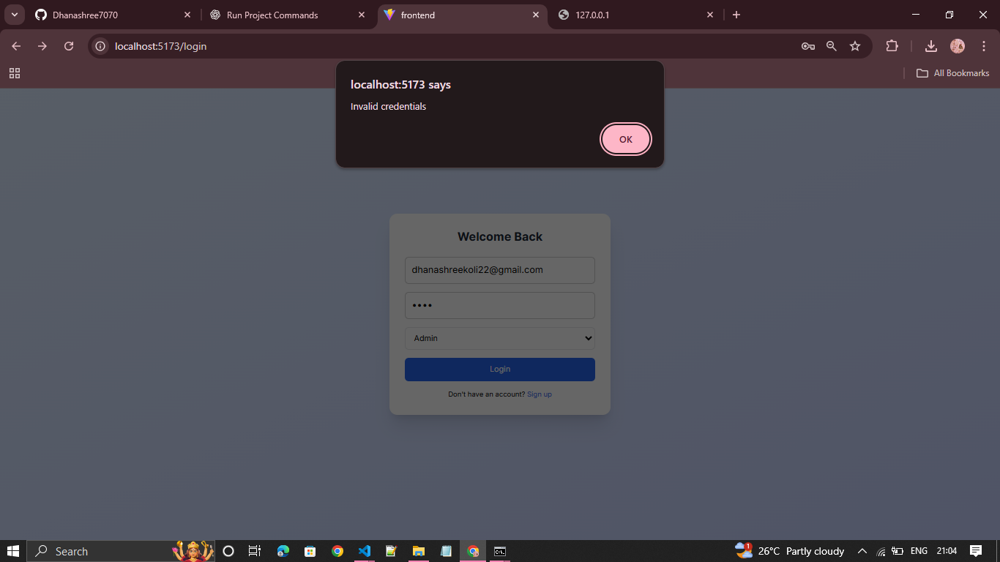

### 2. Admin Dashboard
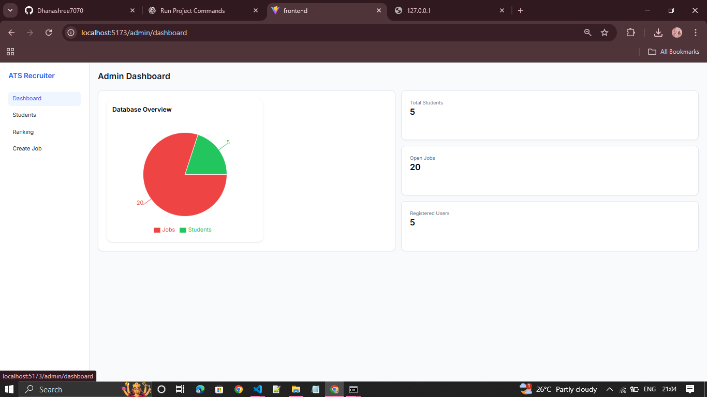

### 3. Student Login
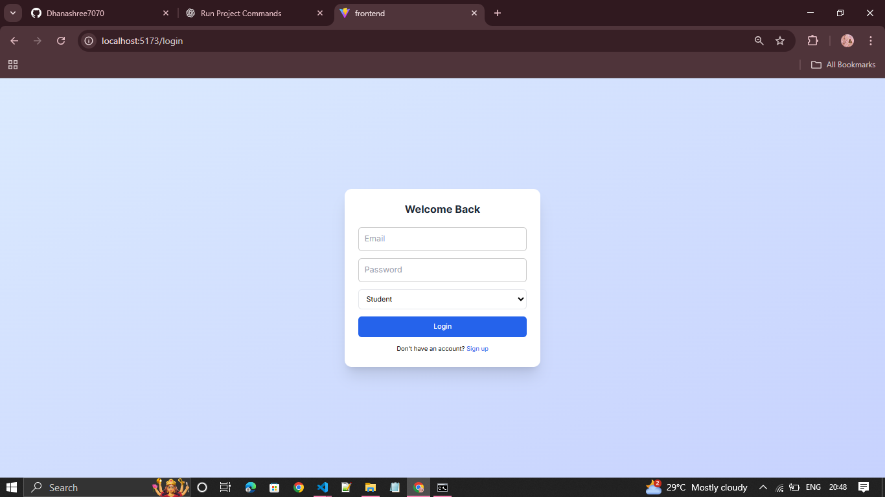

### 4. Login Success


### 5. Student Profile
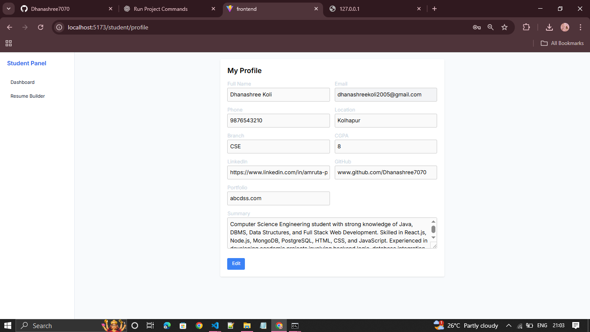

### 6. Resume Template Selection
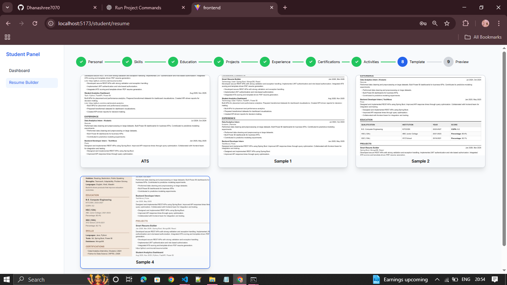

### 7. Resume Preview
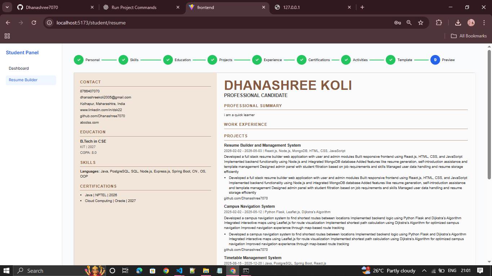

### 8. Download Resume
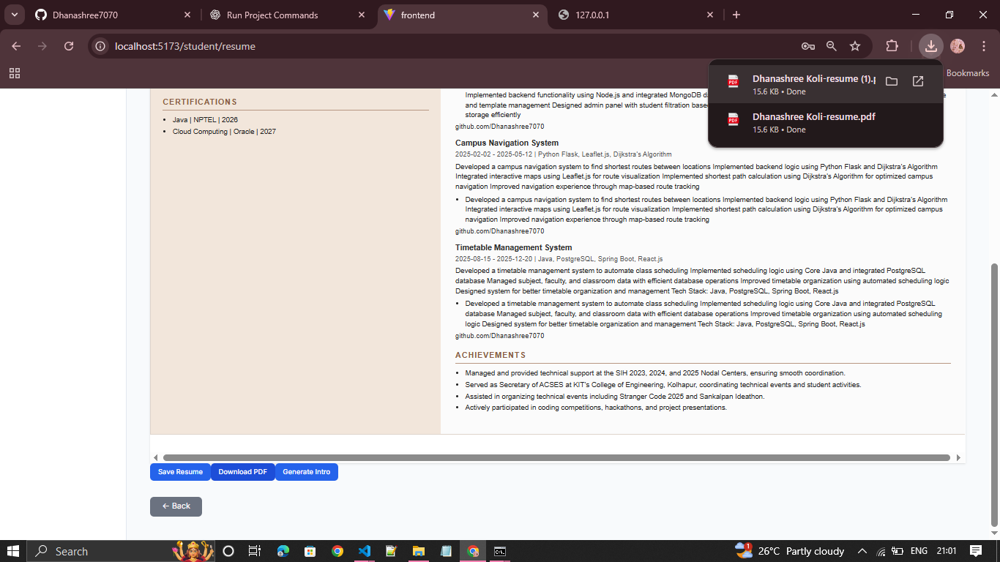

### 9. AI Self-Introduction
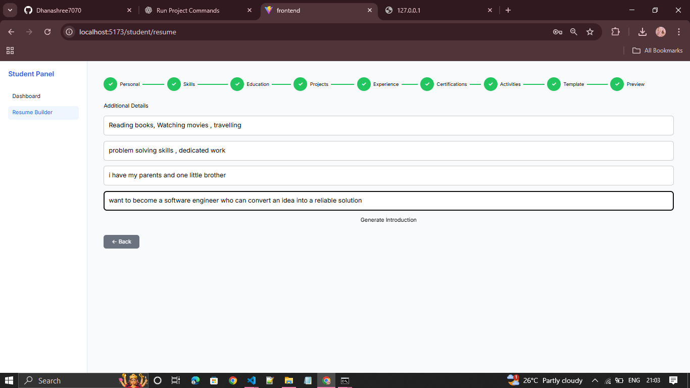

### 10. Generated Introduction Output
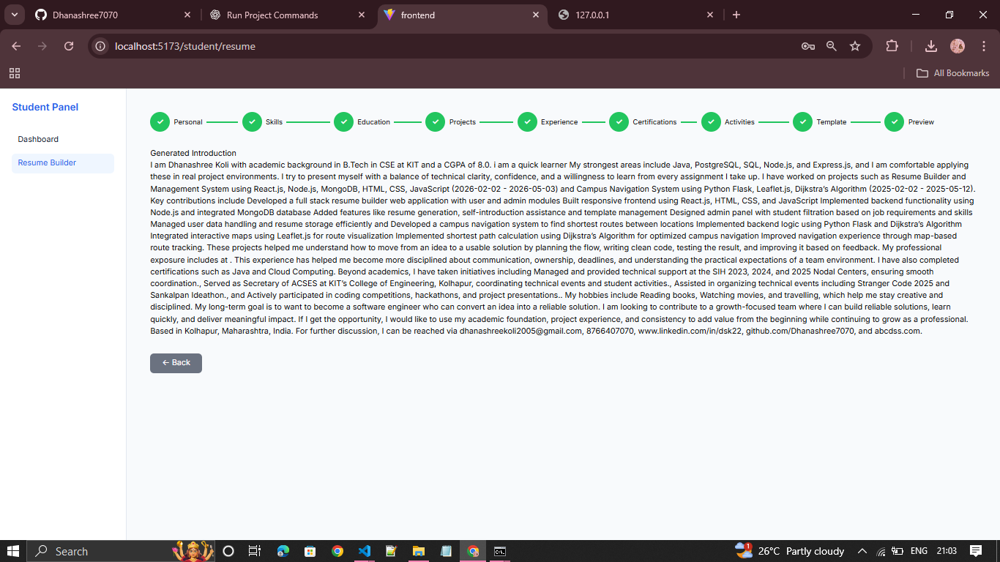

### 11. Job Creation


### 12. Job Creation Success


### 13. Job List
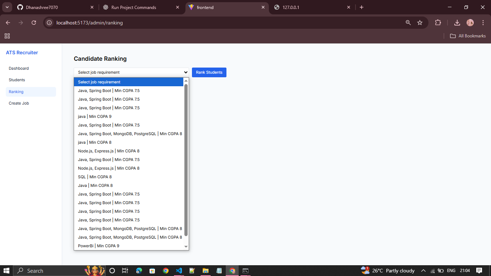

### 14. Student List
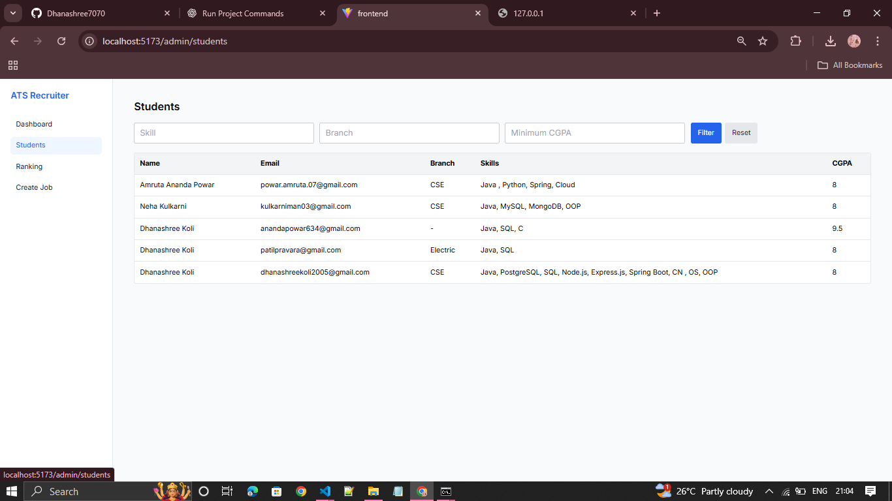

### 15. Student Ranking — View 1
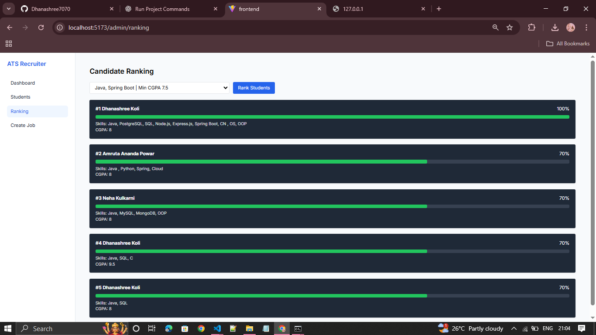

### 16. Student Ranking — View 2
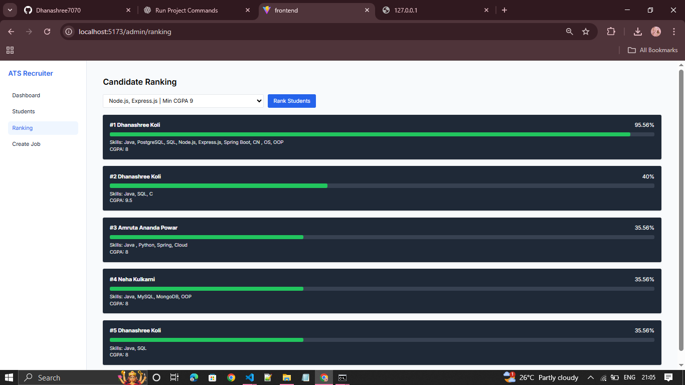

